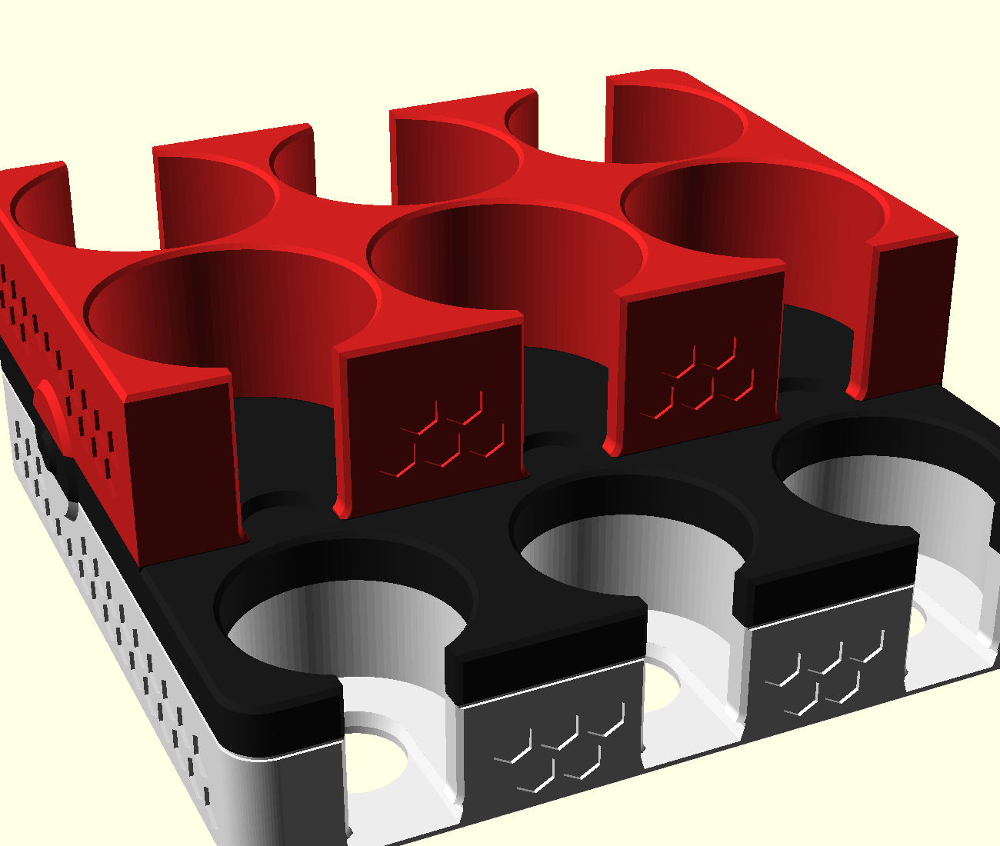

# pokemon-coin-stack-01

Porta-moedas de mesa para **moedas Pokémon TCG** em **bloco único** de 70mm:
9 tubos verticais em que as moedas ficam deitadas e empilhadas.



## Arranjo: arquibancada de 2 degraus

| Fileira | Moeda (medida do usuário) | Furo | Tubos | Fundo do tubo | Profundidade | Capacidade* |
|---|---:|---:|---:|---:|---:|---:|
| Frente (degrau) | Ø42 | Ø44 | 3 | z 4,4 | 31,6mm | ~11 |
| Meio | Ø51,5 | Ø53,5 | 3 | z 36 (nível do degrau) | 34mm | ~12 |
| Trás | Ø51,5 | Ø53,5 | 3 | z 4,4 | 65,6mm | ~24 |

\* A capacidade supõe moeda de 2,7mm, a espessura medida no coin-binder-01.
A espessura não foi medida para este projeto e só altera essa estimativa.

**Por que arquibancada:** cada tubo precisa de uma fenda de dedo aberta para
fora. Com três fileiras de altura cheia, a do meio fica fechada entre as
outras duas. Para pôr os 9 tubos na borda de um bloco de altura cheia, ele
precisaria passar de 210mm. A solução foi parar o degrau da frente em 36mm
e começar os tubos do meio nessa mesma altura. A fenda deles abre para a
frente, por cima do degrau. A fileira de trás tem altura cheia, com a fenda
voltada para trás.

## Como se usa

- **Guardar:** solte a moeda na boca do tubo. O chanfro de 1mm guia a
  entrada, e ela desce deitada até a pilha. A folga é de 1mm por lado.
- **Tirar:** cada tubo tem uma fenda de **20mm** voltada para fora, onde o
  indicador (~16mm) entra inteiro. A borda da moeda fica 4mm para dentro da
  face. Encoste nela e empurre a pilha para cima. O fundo da fenda é reto, no
  nível do fundo do tubo, então até a última moeda fica exposta. Nos tubos
  do meio, o dedo chega deitado sobre o degrau.
- **Última moeda:** o piso de cada tubo tem um **rebaixo de dedo** que sai da
  fenda e entra 12mm no tubo, com 16mm de largura e 2,8mm de fundo. A moeda
  de baixo fica em ponte sobre ele, e a ponta do dedo entra por baixo da
  beirada. Nos tubos pequenos o rebaixo alcançaria o furo do fundo. Ali ele
  vira um canal de 20mm, da largura do furo, fundido nele com paredes
  tangentes, sem bico. Nos tubos da frente e de trás o piso passou para
  4,4mm, para sobrar 1,6mm sob o rebaixo. Isso custa 1 moeda por tubo.
- Os tubos da frente e de trás também têm um **furo Ø20** no fundo, para
  empurrar a pilha por baixo.

## Visual

- Pokébola em **3 cores por altura**: branco até 26mm, faixa preta de 26 a
  36,2mm (o topo do degrau fica preto) e vermelho acima. No IFS da AD5X isso
  dá só **duas trocas de filamento** no job inteiro.
- Medalhão com botão nas duas laterais. Ele atravessa as três faixas e vira
  uma mini-Pokébola. O botão é **preto** e cabe inteiro dentro da faixa
  (z 26,4 a 35,8). Um botão branco foi avaliado e descartado: ele exigiria
  troca de filamento em cada camada da altura da faixa, cerca de 50 trocas
  a mais contra as 2 do job inteiro.
- Colmeia de hexágonos de ponta para cima, rebaixada 0,8mm nas paredes, com
  faixa sólida de 2,6mm até as fendas, a faixa e os cantos.
- Sulco de 0,6mm na base da faixa, para ela aparecer também na impressão
  em uma cor só.

## Medidas

| Item | Medida |
|---|---:|
| Corpo | 172,5 × 166 × 70mm |
| Com medalhões (footprint do job) | 178,1 × 166 × 70mm |
| Passo entre colunas | 56,5mm (pequenos alinhados com os grandes) |
| Parede externa mínima / entre tubos / piso da frente e de trás | 3 / 3 / 4,4mm |
| Rebaixo de dedo | 16 × 12 × 2,8mm (1,6mm de sobra sob ele) |
| Parede na borda da fenda | 4,9mm (grande) / 5,4mm (pequeno) |
| Fenda | 20mm, chanfro de 1mm, raio de 3mm no fundo |
| Chanfros | boca 1,0 (sobra 1mm plano nas divisórias) / topo 1,0 / pé 0,6mm |

## Arquivos e impressão

- `3mf/pokemon-coin-stack-01.3mf`: **o job**. Um objeto com 3 peças:
  branco no filamento 1, faixa no 2 e vermelho no 3. Imprime em pé, de boca
  para cima, sem suporte.
- `stl/pokemon-coin-stack-01.stl`: o bloco inteiro, para imprimir em uma cor.
- `stl/pokemon-coin-stack-01-{white,black,red}.stl`: as zonas de cor que
  entram no 3MF.
- `preview-cores.scad`: abre as 3 malhas coloridas, só para visualização.

Comandos (caminhos absolutos; no Linux use `flatpak run org.openscad.OpenSCAD`):

```
openscad -o <abs>/stl/pokemon-coin-stack-01.stl       -D 'part="block"' <abs>/pokemon-coin-stack-01.scad
openscad -o <abs>/stl/pokemon-coin-stack-01-white.stl -D 'part="white"' <abs>/pokemon-coin-stack-01.scad
openscad -o <abs>/stl/pokemon-coin-stack-01-black.stl -D 'part="black"' <abs>/pokemon-coin-stack-01.scad
openscad -o <abs>/stl/pokemon-coin-stack-01-red.stl   -D 'part="red"'   <abs>/pokemon-coin-stack-01.scad
python3 cartoes/armarouge-card-2cores-01/multicolor3mf.py \
  coin_holders/pokemon-coin-stack-01/3mf/pokemon-coin-stack-01.3mf \
  --name pokemon-coin-stack-01 --colors "#F2F2F2,#1A1A1A,#D32020" \
  --part branco 1 coin_holders/pokemon-coin-stack-01/stl/pokemon-coin-stack-01-white.stl \
  --part faixa  2 coin_holders/pokemon-coin-stack-01/stl/pokemon-coin-stack-01-black.stl \
  --part tampa  3 coin_holders/pokemon-coin-stack-01/stl/pokemon-coin-stack-01-red.stl
```

No Flash Studio, confira se o arquivo abre como **1 objeto com 3 peças**,
cada uma no filamento certo.

### Ajustes de fatiamento

- **Primeira camada de 0,2mm.** Os cortes de cor em 26,0 e 36,2mm caem em
  fronteira de camada. Com primeira camada de 0,3, a grade desloca e uma
  camada fica com cor ambígua.
- **Prime tower:** são só 2 trocas no job, então a torre padrão desperdiça
  filamento à toa. Estreite para ≤18mm e encoste num canto da cama, ou
  desligue e deixe a purga no próprio bico do IFS.
- **Infill de 10 a 15%.** Embaixo dos tubos do meio o bloco é maciço até
  36mm de altura (844 cm³ de volume geométrico). Com infill alto, o
  consumo e o tempo disparam sem ganho de resistência.

Status: **não testado fisicamente**.
